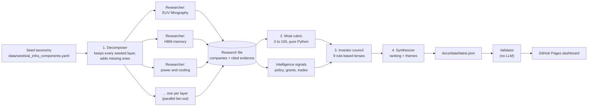
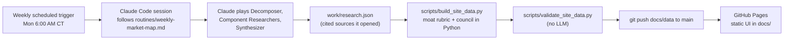

# AI Infrastructure Moat Map

**A multi-agent research pipeline that walks the whole AI infrastructure stack, from copper and specialty gases through EUV scanners, HBM and GPUs up to clouds and foundation-model labs, and finds the suppliers each layer cannot easily replace.** A Decomposer splits the stack into about 25 layers, one Component Researcher per layer finds the leading suppliers with cited sources, a deterministic moat rubric scores each one from 0 to 100, and a council of nine rule-based investor lenses votes on every company before a Synthesizer writes the cross-layer themes. The point of the project is the agent design: fan-out research with typed hand-offs, LLMs used only to gather evidence while all scoring stays in auditable Python, and a hard rule that a "sole supplier" claim earns no credit without two independent sources. By default it runs weekly as a scheduled Claude session, so it costs nothing in API fees.

**Live dashboard:** https://ankittalwar07.github.io/Multi-agent-AI-investment-agent/

> Not investment advice. This is an engineering demo of multi-agent orchestration. Its output may be incomplete or wrong.

## Architecture



| Stage | What it does | LLM? |
|---|---|---|
| **Decomposer** | Turns the seeded taxonomy into the run's list of stack layers. It must keep every seeded layer and justify any it adds. | Yes |
| **Component Researcher** | One agent per layer, run as a LangGraph fan-out. Finds at most five suppliers per layer with share bucket, moat types, switching costs and demand signal, each claim tied to a source. | Yes |
| **Moat rubric** | Scores sole-source status, market share, IP and process moats, regulatory moats, switching costs and demand ([`moat_rubric.py`](src/investment_agent/scoring/moat_rubric.py)). | No |
| **Intelligence agent** | Aggregates non-financial signals such as government funding, export controls and disclosed trades ([`intelligence/`](src/investment_agent/intelligence)). | No |
| **Investor council** | Nine rubrics modeled on well-known investing styles (quality, value, growth, macro, cycle risk) each vote and explain why ([`council/`](src/investment_agent/council)). | No |
| **Synthesizer** | Ranks every company and writes the summary and cross-layer themes, dropping any claim it cannot trace to evidence. | Yes |

The prompts for the three LLM agents live in one versioned registry ([`prompts.py`](src/investment_agent/agents/prompts.py)), and the same contracts drive the live pipeline, the offline demo and the Claude routine.

## Design highlights

**LLMs gather evidence, code makes the calls.** Every score and every council vote is a pure Python function of the research file, so the same evidence always gives the same answer, each verdict names the rule that fired, and anyone can re-derive the dashboard from [`build.py`](src/investment_agent/site/build.py). Only the Decomposer, the Researchers and the Synthesizer use a model.

**Sole-source claims have to be proven.** Calling a company "the only supplier" is the most valuable and most abused claim in supply-chain research. The rubric awards its 30 points only when the evidence comes from at least two different web domains. Otherwise the claim is shown on the dashboard as "claimed, not credited."

**A council that disagrees on purpose.** Five lenses lean toward quality and growth and four toward valuation and cycle risk, so a crowded AI name is as likely to draw a "pass" as a "yes." The dashboard shows each lens's vote and reason next to the moat score, so a reader sees where the debate is.

**Cost-aware live path.** When run with an API provider, a two-tier design does one cheap triage call per layer and keeps the multi-step ReAct research for the companies a user picks. A multi-provider wrapper rotates between Gemini, Groq and local Ollama on rate limits, and a resumable SQLite-backed run picks up where it stopped.

## How it runs with no API cost



The default mode is a **scheduled Claude Code routine**. Instead of paying per token, a weekly Claude session acts as the LLM agents itself, following the repo's own prompts. [`routines/weekly-market-map.md`](routines/weekly-market-map.md) is the complete standalone prompt. The session writes one research file, the repo's own code scores it and runs the council, the validator checks it (https citations on every company, no placeholder URLs, no secrets, scores that add up), and only `docs/data/` is committed. GitHub Pages serves the static UI in [`docs/`](docs) (vanilla JS, no build step), which reads that data.

| Mode | Who plays the agents | Cost | How to run |
|---|---|---|---|
| **Claude routine** (default) | A scheduled Claude Code session | No per-token API spend | Trigger runs `routines/weekly-market-map.md` |
| **Demo** | The real LangGraph pipeline with a deterministic mock LLM | Free, offline | `python -m investment_agent.cli run --mock` |
| **Live** (optional) | Gemini, Groq, local Ollama, Anthropic or OpenAI | Free tiers or paid per token | `python -m investment_agent.cli run --provider gemini` with keys in `.env` |

The dashboard ships with sample data from the demo pipeline (marked `sample: true`, with a banner in the UI) until the first scheduled run replaces it with cited research.

## Run it locally

Requires Python 3.11+.

```bash
python -m venv .venv && . .venv/bin/activate
pip install -e ".[dev]"

# The static dashboard (what GitHub Pages serves)
python -m http.server -d docs 8080                 # open http://127.0.0.1:8080/

# Offline demo of the full pipeline: mock LLM, no keys, no network
python -m investment_agent.cli run --mock
python scripts/export_demo_data.py                 # regenerate the sample dashboard data

# The full Streamlit research app (8 pages, deep-dive queue, editable DCF)
streamlit run streamlit_app.py                     # toggle Demo mode in the sidebar

# Checks (all offline)
pytest -q
python scripts/validate_site_data.py
```

### Live provider path (optional)

```bash
cp .env.example .env                               # add GOOGLE_API_KEY, GROQ_API_KEY, or point at Ollama
python scripts/test_gemini.py                      # check a key works
PYTHONPATH=src python scripts/overnight_run.py --providers gemini,groq,ollama
```

The overnight runner rotates providers on rate limits, saves progress after every layer, and resumes with `--resume <run_id>`. Runs land in `data/runs/` as a SQLite file plus JSON and Markdown summaries, and the Streamlit app reads them.

## Repo layout

```
Multi-agent-AI-investment-agent/
├── routines/
│   ├── weekly-market-map.md   # standalone prompt for the scheduled Claude session (default mode)
│   └── example-research.json  # research-file shape (sample values)
├── docs/                      # GitHub Pages dashboard (index.html, app.js, style.css)
│   ├── data/                  # latest.json + history/ (written by the routine)
│   └── architecture.md, cost-optimization.md, glossary.md, images/
├── src/investment_agent/
│   ├── agents/                # decomposer, component + triage researchers, synthesizer, prompts
│   ├── graph/                 # LangGraph fan-out, run state, resumable pipeline
│   ├── scoring/moat_rubric.py # deterministic 0 to 100 moat score
│   ├── council/               # nine investor-lens rubrics and consensus
│   ├── intelligence/          # policy, funding and trade signals
│   ├── llm/                   # Gemini, Groq, Ollama, Anthropic, OpenAI, mock, multi-provider rotation
│   ├── site/build.py          # research file to dashboard JSON (no LLM)
│   ├── storage/               # SQLite schema and repository
│   └── tools/                 # web search, fetch, seed lookup, citations
├── pages/ + streamlit_app.py  # Streamlit research app
├── scripts/
│   ├── build_site_data.py     # score + council + write docs/data
│   ├── validate_site_data.py  # no-LLM checks before publishing
│   ├── export_demo_data.py    # sample data from the offline demo
│   └── overnight_run.py       # resumable multi-provider runner
├── data/seeds/                # seeded stack taxonomy
└── tests/                     # offline tests
```

More detail: [architecture](docs/architecture.md), [cost optimization](docs/cost-optimization.md), [glossary](docs/glossary.md), [contributing](CONTRIBUTING.md).

## More multi-agent projects

- **Thesis Builder**: a researcher, a three-angle skeptic and a synthesizer stress-test an investment theme, with LLM-judge evals. [repo](https://github.com/ankittalwar07/thesis-builder), [live UI](https://ankittalwar07.github.io/thesis-builder/)
- **AI Demand Watch**: five research agents and an editor track daily signals of AI demand. [repo](https://github.com/ankittalwar07/warning-signaks-for-AI-economy-), [live UI](https://ankittalwar07.github.io/warning-signaks-for-AI-economy-/)

## Author

Built by Ankit Talwar. [LINKEDIN LINK NEEDED]

## Disclaimer

This project is research automation for a portfolio demo. Nothing in it is a recommendation to buy or sell any security. The investor-lens rubrics are simplified rules inspired by public investing styles and do not represent the views of any person.
